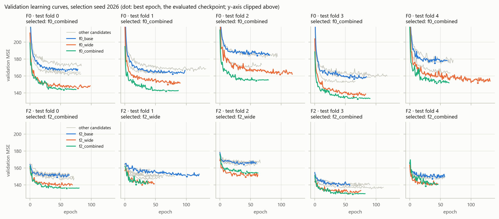
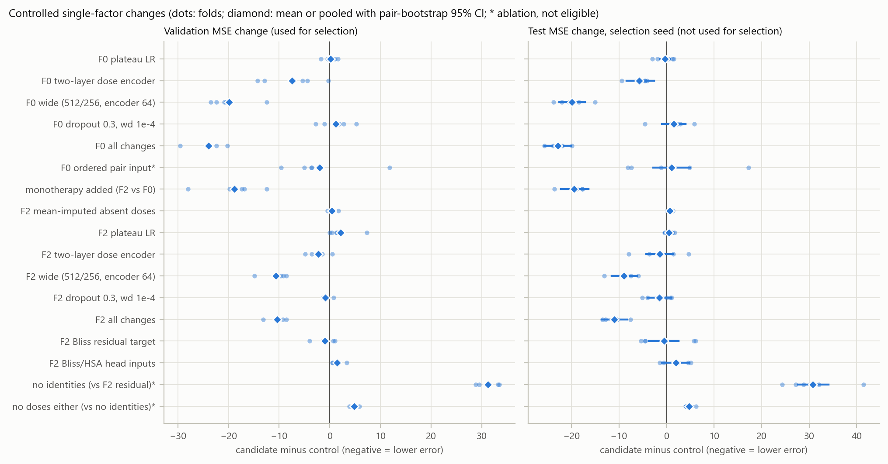
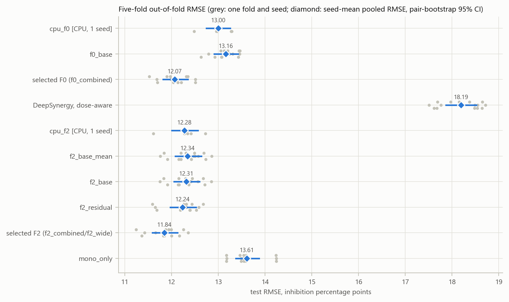
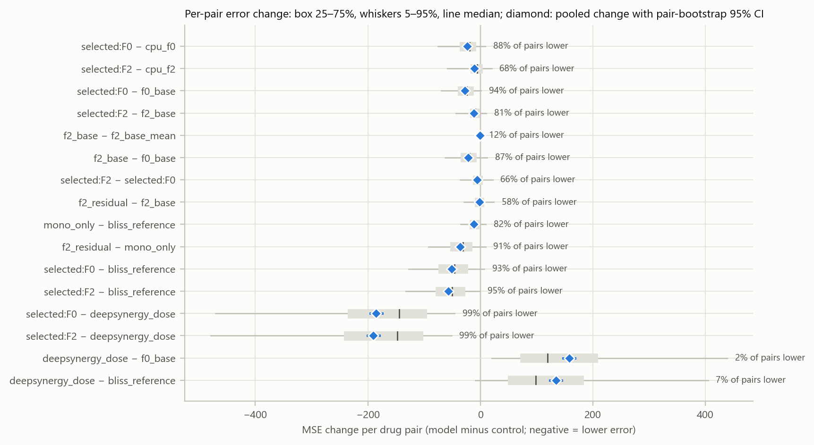
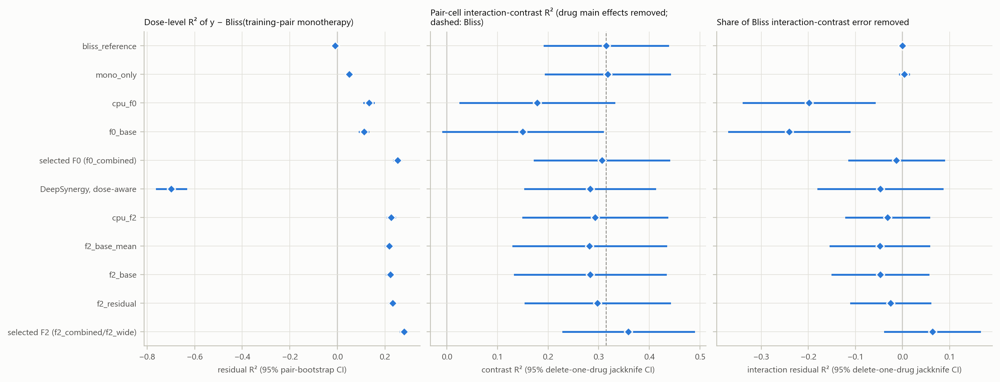
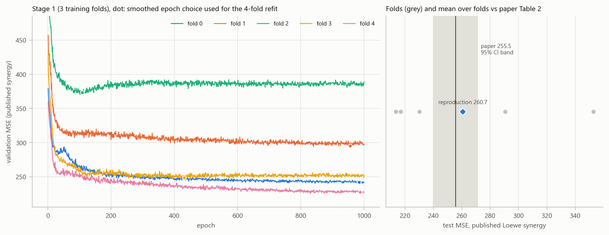
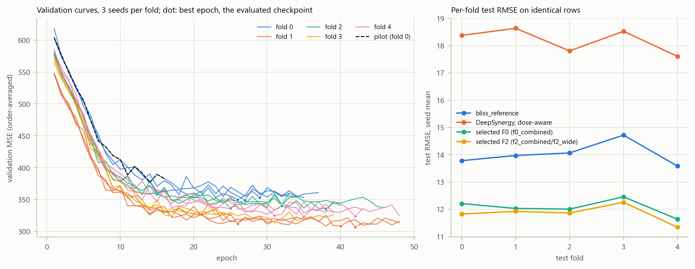

# Neural results: GPU benchmark and DeepSynergy reproduction

Development results on the already examined ONEIL screen (DrugComb v1.4), not
independent confirmation. Every number below is read from the tables in
[results/neural_benchmark](../results/neural_benchmark); the commands at the end
regenerate them. Errors are in inhibition percentage points; ΔMSE < 0 favours
the first model.

## Report section

**Task and protocol.** The networks predict dose-level percentage inhibition for
held-out drug pairs: 1,475,328 ONEIL combination rows, 583 pairs, 38 drugs, 39 cell
lines, under the five published pair folds. F0 networks see drug and cell identities
and both doses. F2 networks also see each drug's single-agent response in the same
cell at the same dose, taken from training pairs. Per fold, validation MSE chose among
18 frozen candidates. The chosen models were then rerun with three seeds. Seed SD is
reported apart from the grouped intervals, which resample drug pairs (bootstrap) or
delete one drug at a time (jackknife).

**Accuracy.** Selected F2 reaches RMSE 11.84 and R² 0.878. That is 28.7% lower MSE
than the training-pair Bliss reference (ΔMSE −56.5; pair bootstrap [−59.9, −52.9];
drug jackknife [−67.2, −45.9]). F2 beats Bliss in every fold and seed and on 95.4%
of pairs. Without monotherapy, selected F0 is 3.7% worse than F2 and 26.0% better
than Bliss. The published DeepSynergy network, given doses and trained on the same
rows and folds, reaches RMSE 18.19 and R² 0.713. That is 68.2% more MSE than Bliss.
Selected F2 has 57.6% lower MSE than DeepSynergy; F2 is lower in every fold and seed
pairing and on 99.1% of pairs.

**Beyond Bliss.** Most of the gain is at the level of drugs and doses, not pair-specific
interaction. After drug main effects are removed within each fold and cell, the
measures are:

- **Interaction contrast.** Selected F2 explains 0.359 of the pair-cell interaction
  contrast, against 0.315 for Bliss. The difference, +0.044 (jackknife
  [−0.026, +0.114]), is not established.
- **Error Bliss leaves.** F2 removes 6.4% of Bliss's interaction-contrast error
  (jackknife [−3.7%, +16.5%]).

All of these are predictions of measured response on one examined screen. A lower
error than Bliss is not evidence of biological synergy.

**Monotherapy inputs.** In the export, a drug's single-agent response at a given cell
and dose is identical across every block, partner and replicate. Over 6,168 such keys
the largest spread is 0.0023 points. F2 and Bliss therefore read one single-agent curve
per drug and cell, independent of any combination outcome. For a new pair of screened
drugs, these values exist before the combination is tested, at the screened doses.

Ninety drug/cell/dose keys occur in only one pair, so they are absent from the
training lookup when that pair is held out (3,360 test rows). Selected F2 interpolates
these doses along the drug-cell curve. That rule can be chosen from single-agent data
alone: holding out one dose at a time, interpolation gives RMSE 17.3 against 30.8 for
the training mean. Its effect on combination error at the production size (ΔMSE −0.7)
is not established. That effect was measured only after the subgroup was found in
test errors, so it is post hoc. The original mean-imputed F2 results are kept.

**Final neural results** ([selected_models.csv](../results/neural_benchmark/selected_models.csv)). These
are pooled out-of-fold rows, the same 1,475,328 for every model. Seed SD is the spread
over seeds. The intervals are pair-cluster bootstrap and delete-one-drug jackknife.
Verdicts follow the rule under Paired comparisons.

| Model | Inputs | Seeds | RMSE (seed SD) | Pair bootstrap 95% CI | Drug jackknife 95% CI | R² | Pearson | Residual R² | Contrast R² [jackknife] | ΔMSE vs Bliss | ΔMSE vs selected F2 |
|---|---|---|---|---|---|---|---|---|---|---|---|
| Selected F2 network | identities, doses, training-pair monotherapy | 3 | 11.84 (0.015) | [11.59, 12.13] | [11.08, 12.60] | 0.878 | 0.937 | 0.280 | 0.359 [0.230, 0.488] | −28.7% (lower error) | – |
| Selected F0 network | identities, doses | 3 | 12.07 (0.054) | [11.82, 12.35] | [11.31, 12.83] | 0.874 | 0.935 | 0.253 | 0.306 [0.173, 0.439] | −26.0% (lower error) | +3.8% (higher error) |
| DeepSynergy, dose-aware | chemical descriptors, expression, doses | 3 | 18.19 (0.019) | [17.87, 18.53] | [16.42, 19.96] | 0.713 | 0.851 | −0.698 | 0.283 [0.154, 0.411] | +68.2% (higher error) | +135.9% (higher error) |
| Production F2 network | identities, doses, training-pair monotherapy | 3 | 12.34 (0.081) | [12.08, 12.64] | [11.52, 13.16] | 0.868 | 0.932 | 0.218 | 0.282 [0.131, 0.433] | −22.6% (lower error) | +8.6% (higher error) |
| Production F0 network | identities, doses | 3 | 13.16 (0.119) | [12.91, 13.42] | [12.34, 13.97] | 0.850 | 0.922 | 0.112 | 0.150 [−0.008, 0.308] | −12.0% (lower error) | +23.4% (higher error) |
| Bliss reference | training-pair monotherapy, fixed rule | – | 14.03 | [13.78, 14.29] | [13.31, 14.75] | 0.829 | 0.914 | −0.010 | 0.315 [0.193, 0.437] | – | +40.3% (higher error) |
| Additive ridge | identities, doses (additive ridge) | 1 | 24.18 | [23.82, 24.53] | [22.43, 25.92] | 0.493 | 0.702 | −1.999 | 0.001 [−0.003, 0.004] | +197.0% (higher error) | +316.6% (higher error) |
| Training mean | none (training mean) | 1 | 33.96 | [33.57, 34.30] | [31.80, 36.12] | −0.001 | −0.022 | −4.917 | 0.000 [−0.000, 0.000] | +486.0% (higher error) | +722.1% (higher error) |

Team methods are added to this table on the same rows (see Adding team methods).

## Runs and verification

The suite trained 18 candidates on five folds with the selection seed 2026 (90 runs),
selected per fold and group on validation MSE, then added seeds 2027 and 2028 for
seven declared benchmark models (70 runs). For test fold f, fold (f+1) mod 5
validates and the other three train. DeepSynergy ran five folds of its own protocol.
Code was commit `21ca03e` with a clean tree. The frozen CPU references are
`phase2_f0` and `phase2_f2` in [response_metrics.csv](../results/response_metrics.csv)
(seed 2026, one run per fold).

`python -m synergy_artifacts.neural_report verify` passed all 38 checks
([verification.json](../results/neural_benchmark/verification.json)):

- Protocol, base configurations, budget and folds equal the frozen files.
- Every run's configuration equals `synergy_artifacts.suite.candidate_config`, and the 160 run
  folders equal the planned set.
- Every run records commit `21ca03e` with a clean tree, dataset SHA-256 `ea588405…`
  and per-module code hashes equal to `git show 21ca03e`.
- Selection recomputed from run metadata equals `selection.json`.
- Predictions cover exactly each test fold's rows, with matching pair, cell, block
  and dose coordinates.
- Pooled metrics, pair-bootstrap intervals and macro errors recomputed from
  predictions match the stored values (relative tolerance 1e-9).
- Histories agree with the best epoch and patience stopping. One run, `f0_ordered`,
  reached the 200-epoch budget.
- Best checkpoints load weights-only and reproduce stored predictions on CPU within
  2.6e-5 (2,000 rows per run).
- No run was resumed or moved to `failed/`.
- CPU reference predictions match the hashes in `response_metrics.csv`.
- DeepSynergy settings, input hashes, test rows, epoch choices, fold metrics and fold
  means recompute exactly. Its report does not record a commit; it ran from the same
  clean checkout.
- **Dose-aware DeepSynergy, protocol and runs.** Its frozen protocol hash matches. All
  15 seed-fold runs record commit `ff09f90` with a clean tree. Each run's dataset and
  feature hashes and code hashes equal the commit's, and each ran on CUDA
  deterministically.
- **Dose-aware DeepSynergy, outputs.** Test rows and order-averaged predictions match;
  metrics recompute; histories follow the stopping rule. Each run records its best
  checkpoint's SHA-256. The pilot wrote no test predictions.

After analysis, re-hashing showed that every pre-existing and imported result file
was unchanged.

## Validation selection (90 runs)

Each candidate changes one stated factor relative to its control. Δ validation is
the change in best-checkpoint validation MSE per fold, which selection used. Δ test
is the pooled change on the selection seed, with a pair-bootstrap 95% CI; it was not
used for selection ([candidates.csv](../results/neural_benchmark/candidates.csv),
[selection.csv](../results/neural_benchmark/selection.csv)).

| Candidate (control) | Parameters | Δ validation mean [min, max] | Folds lower | Selected | Δ test [95% CI] |
|---|---|---|---|---|---|
| f0_plateau (f0_base) | 22,945 | +0.2 [−1.7, +1.6] | 2/5 | 0/5 | −0.3 [−1.4, +0.7] |
| f0_deep (f0_base) | 24,001 | −7.4 [−14.3, −0.2] | 5/5 | 0/5 | −5.7 [−8.4, −2.6] |
| f0_wide (f0_base) | 220,225 | −19.9 [−23.5, −12.5] | 5/5 | 0/5 | −19.9 [−22.5, −17.1] |
| f0_regularized (f0_base) | 22,945 | +1.2 [−2.8, +5.2] | 2/5 | 0/5 | +1.5 [−0.9, +4.1] |
| f0_combined (f0_base) | 224,385 | −23.9 [−29.6, −20.2] | 5/5 | 5/5 | −22.8 [−25.7, −20.0] |
| f0_ordered* (f0_base) | 22,945 | −2.0 [−9.6, +11.9] | 4/5 | – | +1.0 [−2.8, +5.0] |
| f2_base (f0_base) | 23,009 | −18.9 [−28.0, −12.4] | 5/5 | 0/5 | −19.4 [−22.2, −16.4] |
| f2_base_mean (f2_base) | 23,009 | +0.4 [−0.4, +1.7] | 1/5 | 0/5 | +0.7 [−0.1, +1.5] |
| f2_plateau (f2_base) | 23,009 | +2.1 [+0.0, +7.3] | 0/5 | 0/5 | +0.5 [−0.5, +1.4] |
| f2_deep (f2_base) | 24,065 | −2.3 [−4.8, +0.5] | 4/5 | 0/5 | −1.4 [−4.2, +1.4] |
| f2_wide (f2_base) | 220,353 | −10.6 [−14.9, −8.6] | 5/5 | 2/5 | −9.0 [−11.5, −6.2] |
| f2_regularized (f2_base) | 23,009 | −0.8 [−1.3, +0.8] | 4/5 | 0/5 | −1.5 [−4.0, +1.0] |
| f2_combined (f2_base) | 224,513 | −10.4 [−13.2, −8.6] | 5/5 | 3/5 | −10.9 [−13.6, −8.3] |
| f2_residual (f2_base) | 23,009 | −1.0 [−4.0, +1.0] | 3/5 | 0/5 | −0.5 [−3.7, +2.5] |
| f2_refinput (f2_base) | 23,265 | +1.4 [+0.5, +3.3] | 0/5 | 0/5 | +2.0 [−0.9, +4.7] |
| mono_dose* (f2_residual) | 16,801 | +31.3 [+28.8, +33.5] | 0/5 | – | +30.8 [+27.7, +34.0] |
| mono_only* (mono_dose) | 16,737 | +4.9 [+3.8, +5.8] | 0/5 | – | +4.7 [+3.8, +5.6] |

\* Ablation, never eligible for selection.

- **Capacity.** The wider encoder and head lower validation and test MSE in every fold
  (F0 −19.9, F2 −10.6 validation). This is the largest single factor.
- **Dose representation.** A two-layer drug-dose encoder helps F0 (−7.4 in all
  folds), but its F2 effect is unresolved.
- **Optimization and regularization.** The plateau schedule, and dropout 0.3 with
  weight decay 1e-4, have no consistent effect.
- **Combined changes.** All changes together are best for F0. For F2, combined and
  wide tie (mean validation MSE 139.6 vs 139.3).
- **Monotherapy inputs.** At the production size they lower validation MSE in every
  fold (−18.9).
- **Residual learning.** Fitting y minus the training-pair Bliss reference, or adding
  Bliss/HSA to the head, gives no clear gain.
- **Information ablations.** Removing drug/cell identities from the residual model
  adds +31 validation MSE; removing doses as well adds +4.9 more.
- **Symmetry.** The order-dependent concatenation gains no accuracy. Swapping the
  drug order moves its predictions by 9.9 RMS points; the production network is
  exchange invariant.

The SD of validation MSE across the three benchmark seeds has median 1.7 per
model-fold ([runs.csv](../results/neural_benchmark/runs.csv)). For every factor with a
clear validation effect, the test change agrees in sign and size.

**Audit of the F2 choice.** Wide-only F2 (`f2_wide`) is simpler than `f2_combined`
and statistically indistinguishable on validation. The per-fold difference
(wide minus combined) is +2.3, −0.4, −4.3, +1.0 and +0.0, mean −0.3. The seed SD of
validation MSE is 1.1–1.7 for combined and 1.5–2.0 for wide.

The frozen rule takes the lowest validation MSE and prefers fewer parameters only
under an exact tie. It therefore does not permit replacing the selection, and the
mixed per-fold selection stands. Fixing wide-only would have given pooled test MSE
141.3 against 139.4 for combined on the selection seed. That test result was not
used for the decision.




## Five-fold, three-seed benchmark

The table pools out-of-fold rows over all five folds; every row covers the same
1,475,328 observations ([benchmark.csv](../results/neural_benchmark/benchmark.csv)).
For each model:

- RMSE is the seed mean, followed by the SD across seeds.
- The 95% CI is a pair-cluster bootstrap (583 pairs, 1,000 resamples) of the seed
  mean, conditional on the trained models.
- Pair-cell metrics compare row-mean predictions with the row-mean observed
  response, which equals the prepared `panel.parquet` response.
- Residual and contrast R² are defined in the next section.

| Model | Seeds | RMSE (SD) [95% CI] | MAE | R² | Pearson | Macro-pair MSE | Pair-cell RMSE / r | Residual R² | Contrast R² |
|---|---|---|---|---|---|---|---|---|---|
| selected F2 (combined/wide) | 3 | 11.84 (0.015) [11.59, 12.13] | 7.83 | 0.878 | 0.937 | 138.8 | 5.55 / 0.965 | 0.280 | 0.359 |
| f2_residual | 3 | 12.24 (0.021) [11.98, 12.52] | 8.08 | 0.870 | 0.933 | 148.3 | 5.86 / 0.961 | 0.232 | 0.298 |
| f2_base (interpolated) | 3 | 12.31 (0.075) [12.06, 12.60] | 8.23 | 0.868 | 0.932 | 150.0 | 5.98 / 0.960 | 0.222 | 0.283 |
| f2_base_mean (production F2) | 3 | 12.34 (0.081) [12.08, 12.64] | 8.25 | 0.868 | 0.932 | 150.5 | 5.99 / 0.960 | 0.218 | 0.282 |
| CPU F2 (frozen) | 1 | 12.28 [12.01, 12.57] | 8.15 | 0.869 | 0.932 | 149.0 | 5.89 / 0.961 | 0.227 | 0.293 |
| selected F0 (combined) | 3 | 12.07 (0.054) [11.82, 12.35] | 8.06 | 0.874 | 0.935 | 144.3 | 5.78 / 0.963 | 0.253 | 0.306 |
| f0_base (production F0) | 3 | 13.16 (0.119) [12.91, 13.42] | 9.08 | 0.850 | 0.922 | 171.8 | 6.64 / 0.950 | 0.112 | 0.150 |
| CPU F0 (frozen) | 1 | 13.00 [12.75, 13.25] | 8.93 | 0.853 | 0.924 | 168.0 | 6.52 / 0.952 | 0.133 | 0.179 |
| DeepSynergy, dose-aware | 3 | 18.19 (0.019) [17.87, 18.53] | 13.89 | 0.713 | 0.851 | 330.6 | 9.05 / 0.906 | −0.698 | 0.283 |
| mono_only | 3 | 13.61 (0.005) [13.37, 13.87] | 9.12 | 0.839 | 0.916 | 183.8 | 7.21 / 0.941 | 0.050 | 0.318 |
| Bliss reference | – | 14.03 [13.78, 14.29] | 9.40 | 0.829 | 0.914 | 195.2 | 7.63 / 0.939 | −0.010 | 0.315 |
| additive ridge | 1 | 24.18 [23.82, 24.53] | 19.26 | 0.493 | 0.702 | 585.0 | 13.56 / 0.771 | −2.00 | 0.001 |
| training mean | 1 | 33.96 [33.57, 34.30] | 29.63 | −0.001 | −0.022 | 1155.5 | 21.32 / −0.038 | −4.92 | 0.000 |

Per-fold RMSE is in `benchmark.csv`, and every fold-and-seed run is in `runs.csv`.
Pair and cell-line breakdowns are in [groups.csv](../results/neural_benchmark/groups.csv).
For the selected F2 model, median per-pair RMSE is 11.18; macro-cell MSE is 140.4.



### Paired comparisons

All differences are computed on identical rows ([comparisons.csv](../results/neural_benchmark/comparisons.csv)).
ΔMSE averages squared error over seeds before differencing. A comparison is marked
"lower error" only when all of these lie below zero:

- the pair-bootstrap interval;
- the delete-one-drug jackknife interval (38 drugs, which accounts for pairs sharing
  a drug);
- all five fold-level changes;
- all seed pairings.

The intervals are not adjusted for multiplicity; requiring all four conditions is
conservative.

| Comparison | ΔMSE [pair bootstrap] | Drug jackknife | ΔRMSE (ΔMSE %) | Folds lower | Seed pairs lower | Verdict |
|---|---|---|---|---|---|---|
| f0_base − CPU F0 | +4.2 [+1.5, +6.9] | [−0.9, +9.3] | +0.16 (+2.5%) | 1/5 | 0/3 | not established |
| f2_base_mean − CPU F2 | +1.6 [−0.6, +3.9] | [−2.1, +5.4] | +0.07 (+1.1%) | 1/5 | 0/3 | not established |
| selected F0 − CPU F0 | −23.3 [−26.0, −20.7] | [−27.9, −18.7] | −0.93 (−13.8%) | 5/5 | 3/3 | lower error |
| selected F2 − CPU F2 | −10.4 [−12.8, −7.9] | [−15.1, −5.8] | −0.43 (−6.9%) | 5/5 | 3/3 | lower error |
| selected F0 − f0_base | −27.5 [−29.5, −25.6] | [−33.5, −21.5] | −1.09 (−15.9%) | 5/5 | 9/9 | lower error |
| selected F2 − f2_base | −11.3 [−12.9, −9.6] | [−14.6, −8.0] | −0.47 (−7.5%) | 5/5 | 9/9 | lower error |
| f2_base − f2_base_mean | −0.7 [−1.5, −0.2] | [−1.9, +0.4] | −0.03 (−0.5%) | 5/5 | 7/9 | not established |
| f2_base − f0_base | −21.5 [−23.6, −19.3] | [−28.5, −14.6] | −0.85 (−12.4%) | 5/5 | 9/9 | lower error |
| selected F2 − selected F0 | −5.4 [−6.8, −3.9] | [−8.9, −1.8] | −0.22 (−3.7%) | 5/5 | 9/9 | lower error |
| f2_residual − f2_base | −1.9 [−3.5, −0.3] | [−4.8, +1.0] | −0.08 (−1.2%) | 3/5 | 9/9 | not established |
| mono_only − Bliss reference | −11.6 [−12.8, −10.4] | [−15.5, −7.6] | −0.42 (−5.9%) | 5/5 | 3/3 | lower error |
| f2_residual − mono_only | −35.5 [−38.4, −32.7] | [−43.1, −27.9] | −1.37 (−19.2%) | 5/5 | 9/9 | lower error |
| selected F0 − Bliss reference | −51.1 [−54.7, −47.4] | [−62.3, −40.0] | −1.96 (−26.0%) | 5/5 | 3/3 | lower error |
| selected F2 − Bliss reference | −56.5 [−59.9, −52.9] | [−67.2, −45.9] | −2.18 (−28.7%) | 5/5 | 3/3 | lower error |
| selected F0 − DeepSynergy dose | −185.3 [−195.6, −174.5] | [−246.3, −124.2] | −6.12 (−56.0%) | 5/5 | 9/9 | lower error |
| selected F2 − DeepSynergy dose | −190.7 [−200.7, −179.5] | [−252.1, −129.2] | −6.35 (−57.6%) | 5/5 | 9/9 | lower error |
| DeepSynergy dose − f0_base | +157.8 [+146.9, +168.4] | [+98.3, +217.3] | +5.03 (+91.1%) | 0/5 | 0/9 | higher error |
| DeepSynergy dose − Bliss reference | +134.1 [+123.6, +144.5] | [+76.6, +191.7] | +4.16 (+68.2%) | 0/5 | 0/3 | higher error |

The GPU replicates of the production configurations sit 2.5% (F0) and 1.1% (F2) above
the frozen CPU runs in MSE. The CPU runs fall within about 1.3 seed SDs of the GPU
seeds, so they behave like one further seed. GPU and CPU runs differ in dropout random
streams and float32 rounding, so a shared seed does not make them identical.



## Prediction beyond the noninteraction reference

**Reference and residual R².** The reference is R = a + b − ab/100, where a and b
are training-pair monotherapy responses at the row's drug, cell and dose. Absent dose
keys use log-dose interpolation of the same drug/cell training values; held-out
block edges are never used. Residual R² = 1 − SSE / Σ(y − R − mean(y − R))²: the
share of the variance left by R (after a constant shift) that a model removes. The
same R is used for every model, including F0 models that never see monotherapy.

**Contrast R².** Let P remove drug main effects within each fold and cell from the
row-mean pair-cell responses (the methodology's interaction contrast). Then contrast
R² = 1 − ‖P(y − p)‖² / ‖Py‖² is the share of pair-specific interaction a model
predicts. Interaction residual R² = 1 − ‖P(y − p)‖² / ‖P(y − R)‖² is the share of the
interaction error left by Bliss that the model removes. Intervals for both come from
a delete-one-drug jackknife over the 38 drugs.

Findings, on identical rows:

- **The reference explains most variance.** Monotherapy plus a noninteraction rule
  gives R² 0.829 with no fitting. F0 networks reach a similar level from identities
  and doses alone (selected F0 R² 0.874, residual R² 0.253).
- **A learned monotherapy rule adds little.** A network that combines the two
  monotherapy values without identities or doses improves on Bliss by 5.9% MSE
  (residual R² 0.050).
- **Identities and doses add most of the remaining gain.** Adding them removes a
  further 19.2% of MSE (f2_residual, residual R² 0.232). Removing identities alone
  costs +31 validation MSE in every fold. The best network leaves 72% of the
  post-Bliss variance unexplained (residual R² 0.280, pair bootstrap
  [0.264, 0.294]).
- **No established pair-specific gain over Bliss.** The table below gives contrast R²
  with its jackknife interval, the difference from Bliss, and interaction residual
  R². Every interval of the difference from Bliss includes zero, except for the
  production F0 network, which is worse.

| Model | Contrast R² [jackknife] | Minus Bliss [jackknife] | Interaction residual R² [jackknife] |
|---|---|---|---|
| Selected F2 | 0.359 [0.230, 0.488] | +0.044 [−0.026, +0.114] | +0.064 [−0.037, +0.165] |
| Selected F0 | 0.306 [0.173, 0.439] | −0.009 [−0.078, +0.060] | −0.013 [−0.114, +0.088] |
| DeepSynergy, dose-aware | 0.283 [0.154, 0.411] | −0.032 [−0.121, +0.057] | −0.047 [−0.179, +0.085] |
| Production F2 | 0.282 [0.131, 0.433] | −0.033 [−0.105, +0.039] | −0.048 [−0.153, +0.056] |
| Production F0 | 0.150 [−0.008, 0.308] | −0.165 [−0.251, −0.079] | −0.241 [−0.368, −0.113] |
| mono_only | 0.318 [0.195, 0.440] | +0.003 [−0.004, +0.009] | +0.004 [−0.006, +0.013] |
| Bliss reference | 0.315 [0.193, 0.437] | – | – |

The comparison therefore separates two quantities:

- **Response prediction.** The networks have far lower dose-level response error than
  Bliss: −28.7% MSE for selected F2, −26.0% for selected F0.
- **Pair-specific interaction.** They predict no more of the pair-specific
  interaction than Bliss does, within the drug-level uncertainty.

What the results establish is narrow. For held-out pairs of drugs seen in other pairs
within this screen, the networks reproducibly predict more of the measured response
than a monotherapy-based Bliss reference. They do not establish:

- biological synergy;
- performance on unseen drugs or cell lines;
- generalization beyond ONEIL.



## Monotherapy provenance

The audit is in [monotherapy.csv](../results/neural_benchmark/monotherapy.csv).

**Where the inputs come from.** F2 and the Bliss reference read single-agent
responses from the block edges of training pairs. An edge is the row where the
partner dose is zero.

**One curve per drug and cell.** In the DrugComb v1.4 ONEIL export, every
drug/cell/dose key takes the same edge value in every block, partner and replicate
that contains it. There are 6,168 keys, each in 4–176 blocks (median 148), and the
largest spread is 0.0023 points. The export therefore holds one single-agent curve
per drug and cell, evaluated at the combination doses. Of the 1,482 curves, 1,332 have
4 doses, 105 have 5 and 45 have 7. No edge value depends on the outcome of a
particular combination.

DrugComb describes the values as separately measured monotherapies interpolated onto
the combination doses. The original single-agent assay and that interpolation step
cannot be checked from the export.

**Availability for unseen combinations.** For a new pair of drugs already screened
alone in the cell line, the inputs are single-agent quantities. They are available
before the combination is tested at any dose on the screened grid. F2 is therefore a
prospective model for new pairs of screened drugs. It is not one for unscreened
drugs or for doses off the grid.

**Missing doses.** Ninety keys occur in a single pair. When that pair is held out,
its doses are absent from the training lookup. This affects 3,360 test rows: 8 pairs
and 15 cells, with 240, 960, 1,200, 720 and 240 rows in folds 0–4. The two rules
behave as follows:

- **Production F2 (`f2_base_mean`).** Absent keys take the training lookup mean.
  Subgroup RMSE is 26.5, on GPU and CPU alike.
- **Interpolation (`f2_base` and every other benchmark F2 candidate).** Absent keys are
  interpolated in log dose along the same drug-cell training values. Subgroup RMSE is
  19.6, close to F0 (20.5 GPU, 19.5 CPU) and Bliss (18.9).

Training is bitwise identical under either rule; the best epoch agrees in 14 of 15
seed-fold runs. On covered rows both rules give RMSE 12.29.

**Prospective evaluation.** The choice of rule needs no combination outcome. On
single-agent data alone, the comparison is:

| Single-agent target | Training mean RMSE (MAE) | Interpolation RMSE (MAE) |
|---|---|---|
| Truly absent keys (n = 210) | 25.6 (20.8) | 13.9 (5.3) |
| Each training dose held out (n = 30,540) | 30.8 (26.1) | 17.3 (10.4) |
| Interior doses held out (n = 15,720) | 27.7 (23.2) | 12.3 (7.5) |

The effect on combination error cannot be evaluated prospectively on ONEIL, for two
reasons:

- The subgroup was identified from test errors of the CPU models.
- Every ONEIL row has already served as a test row.

The pooled change (ΔMSE −0.7, not established) is therefore post hoc. It amounts to
0.5% of selected-F2 MSE, so no comparison above depends on it. Production F2 results
are kept unchanged beside the interpolated models. A clean test would fix the rule
from single-agent data and apply it to a screen not yet examined.

## DeepSynergy reproduction audit

`synergy_artifacts.deepsynergy reproduce` trains the published architecture on the original
DeepSynergy inputs ([deepsynergy.csv](../results/neural_benchmark/deepsynergy.csv)).

| Aspect | Reproduction | Relation to paper |
|---|---|---|
| Target | Published labels (Combenefit Loewe synergy, `labels.csv` SHA-256 `4ef40678…`) | Same |
| Samples | 23,052 source rows (583 pairs × 39 cells; 315 duplicate pair-cell rows kept), trained in both drug orders | Same layout as `X.p.gz` (46,104 rows) |
| Features | `X.p.gz` rows split into 38 drug vectors (4,387: ECFP6, physicochemical, toxicophores) and 39 cell vectors (3,984 FARMS expression). Repeated blocks are bitwise identical; no nonfinite values | Same |
| Normalization | `tanh_norm` over the doubled training rows of each fit; zero-variance columns removed | Same |
| Folds | Published pair folds, identical to the neural benchmark folds | Same |
| Network | Input dropout 0.2, 8192–4096 ReLU, dropout 0.5, linear output, truncated He-normal initialization | Published best configuration |
| Optimization | SGD, lr 1e-5, momentum 0.5, batch 64, at most 1,000 epochs | Same |
| Epoch choice | Stage 1 trains three folds against validation fold (k+1) mod 5 and takes the window-25 moving-average argmin; stage 2 refits on four folds for that many epochs | Published CV example; the inner hyperparameter search was not repeated |
| Test prediction | Mean of both drug orders (doubled-row MSE 261.3 also recorded) | Minor |
| Aggregation | Mean and SD over five folds | Same |
| Implementation | PyTorch, deterministic IEEE float32, one seed | Keras; numerical differences expected |

Fold MSE is 213.5, 230.0, 290.7, 352.7 and 216.9. Results relative to the paper:

- **Agreement.** The mean of 260.7 lies inside the paper's 95% CI (239.9–271.1);
  RMSE 16.07 ± 1.81 vs 15.91 ± 1.56, Pearson 0.726 ± 0.037 vs 0.73 ± 0.04.
- **Pooled rows.** MSE 260.7, R² 0.503. A training-mean predictor gives MSE 525.7.
- **Budget-limited folds.** The smoothed epoch choice sits at 956–987 of 1,000 epochs
  in three folds, so those folds may be limited by the paper's epoch budget. Fold 2
  selects 109 epochs after visible overfitting.

**Comparability.** The reproduction shares only the folds with the response
benchmark. It differs in target (Loewe synergy, SD 22.9, against measured inhibition,
SD 34.0), sample unit, inputs, training data (a four-fold refit) and aggregation.
Neither its RMSE of 16.07 nor its R² of 0.50 can be placed beside the response
models; the matched comparison follows.



## Dose-aware DeepSynergy on the shared rows

`python -m synergy_artifacts.deepsynergy dose` trains the published DeepSynergy network on
exactly the benchmark rows, folds, target and metrics of F0/F2. It is kept apart from
the faithful reproduction above. The protocol is
[deepsynergy_dose.json](../configs/deepsynergy_dose.json).

**Adaptation.** The original features carry no dose, so a dose is added to each drug:

- **Input.** Each row is drug A descriptors (2,427 kept after `tanh_norm`), A's
  standardized log10 dose, drug B descriptors, B's dose, then cell expression
  (3,984). That gives 8,840 inputs and 106.0 million parameters.
- **Training data.** Training rows are used in both drug orders. The target is
  measured inhibition, centred on the training mean.
- **Normalization.** All normalization statistics come from the training folds only.

Network, normalization and optimizer are the paper's. As for F0/F2, there is no refit:
the epoch with the lowest order-averaged validation MSE is evaluated, and test
predictions average both drug orders.

**Budget.** It was set from a validation-only pilot on fold 0, seed 2026, before any
test prediction:

- Validation MSE fell from 604.0 at epoch 1 to a best of 376.7 at epoch 13 of 16, and
  was still falling.
- The longest stretch without improvement was 2 epochs.

The frozen budget is therefore 48 epochs (three times the pilot) with patience 8. The
fold-0 run reproduced the pilot's first epoch exactly. Seeds 2026–2028 and folds 0–4
give 15 runs.

**Results.** All 15 runs passed verification.

- **Stopping.** Best epochs were 17–42. Thirteen runs stopped on patience and two
  at the 48-epoch budget. In two runs (seed 2026 fold 1 and seed 2027 fold 4) the
  best epoch fell in the last eight epochs, so they may be limited by the budget.
- **Accuracy.** Pooled over folds: RMSE 18.19 (seed SD 0.019; pair bootstrap
  [17.87, 18.53]), MAE 13.89, R² 0.713, Pearson 0.851. Per-fold RMSE is 17.6–18.6.
- **Pair-cell level.** RMSE 9.05, r 0.906.

The four comparisons declared with the protocol are in the paired-comparison table:

- **Against the networks.** Selected F0 and F2 have 56.0% and 57.6% lower MSE.
  DeepSynergy has 91.1% higher MSE than production F0.
- **Against Bliss.** DeepSynergy has 68.2% higher MSE.
- **Consistency.** Every difference holds in all folds and seed pairings and under
  both interval types.

DeepSynergy's pair-cell contrast R² is 0.283 (jackknife [0.154, 0.411]), close to
production F2 and to Bliss. Its deficit is therefore in drug- and dose-level response,
not in pair-specific interaction.

This run does not separate the possible reasons:

- the published optimizer (SGD, lr 1e-5) over about 1.8 million doubled rows per
  epoch, for at most 48 epochs;
- the budget limit in two runs;
- dose entering as one scalar beside 2,427 descriptors.

Changing any of these would be a new, separately declared experiment.



## Compute environment

**Hardware and software.** One NVIDIA A100-SXM4-80GB per job (driver 570.86.10,
CUDA 12.8) with torch 2.12.1+cu129 and Python 3.12. Deterministic algorithms and
IEEE float32 were used throughout, with no TF32.

**Suite.** It ran on a GPU with no other process in 45 ten-minute samples, at a
median utilization of about 31%. Fit time was 7.1 GPU-hours over 160 runs (median
59–264 s per candidate) and peak allocation was 725 MB.

**DeepSynergy.** Its GPU was shared throughout with another user's 74,140 MiB
process (99–100% combined utilization in 42 of 43 samples), so its 7 h 12 min wall
time is inflated.

**Dose-aware DeepSynergy.** The 15 runs took 26.3 GPU-hours of fitting: median 1.7 h
per run, and 122–253 s per epoch (median 168). Peak allocation was 2.2 GiB. Thirteen
runs shared their GPU with other users' processes in every ten-minute sample. The two
runs on an otherwise idle GPU took about 122 s per epoch.

**CPU and devices.** Each long job had one CPU core while the protocol sets four
torch threads. SLURM on the node did not constrain devices, so each job exported its
assigned physical GPU index.

**Effect on results.** Wall time reflects contention and the one-core allocation,
not model quality. Results are deterministic given seed and device: the GPU check
reproduced repeat and resume runs bitwise, so contention cannot change any number
above.

## Reproduction

On a CUDA machine (prepared data and the frozen CPU runs in place):

```sh
python -m synergy_artifacts.suite run --protocol configs/neural_benchmark.json --output results/neural/runs/benchmark_v1 --stage all --device cuda
python -m synergy_artifacts.deepsynergy reproduce --output results/neural/runs/deepsynergy_original --folds 0 1 2 3 4 --device cuda
python -m synergy_artifacts.deepsynergy dose --protocol configs/deepsynergy_dose.json --output results/neural/runs/deepsynergy_dose_pilot --pilot
python -m synergy_artifacts.deepsynergy dose --protocol configs/deepsynergy_dose.json --output results/neural/runs/deepsynergy_dose --seeds 2026 --folds 0
```

The last command runs one seed and fold; the 15 runs are independent jobs.

Then, with those outputs and `phase2_*` under `results/neural/runs/`:

```sh
python -m pip install -e ".[plots]"
python -m synergy_artifacts.neural_report verify --output results/neural_benchmark
python -m synergy_artifacts.neural_report analyze --output results/neural_benchmark
python -m synergy_artifacts.neural_report figures --output results/neural_benchmark
```

`analyze` refuses to run unless verification passed, and `figures` reads only the
saved tables. Predictions, checkpoints and data stay local. Dose-aware DeepSynergy
checkpoints stay on the training machine; each run records its best checkpoint's
SHA-256.

## Adding team methods

Each method supplies `fold_<k>.parquet` for k = 0–4, holding `observation_id` and
`prediction` for every test row of fold k, once each. This is the shared prediction
contract with one file per fold. Then:

```sh
python -m synergy_artifacts.neural_report analyze --output results/neural_benchmark --method GP=results/gp/oof --method CF=results/cf/oof
python -m synergy_artifacts.neural_report figures --output results/neural_benchmark
```

Each method is added on identical rows:

- **Tables.** It gets a row in `benchmark.csv` and `selected_models.csv`: pooled metrics,
  pair-bootstrap and drug-jackknife intervals, contrast R² and interaction residual R².
- **Comparisons.** It is compared, with the same verdict rule, against selected F2,
  selected F0, the additive ridge and Bliss in `comparisons.csv`.
- **Figures.** It appears in figures 3 and 5.

Incomplete or duplicated coverage is rejected.

## Remaining for the team report

- **Team comparison.** GP and CF need out-of-fold `fold_<k>.parquet` files, then
  `analyze --method` (see Adding team methods). Nothing else blocks the shared table.
- **DeepSynergy budget.** Two of 15 runs had their best epoch in the last eight epochs
  of the frozen budget. A longer budget or a tuned variant would need a newly declared
  protocol.
- **Confirmation.** All results are development estimates on ONEIL. A confirmatory
  analysis needs a screen not yet examined, with these fixed in advance:
  - `f2_combined` and `f0_combined`;
  - the interpolation rule for absent monotherapy doses.
