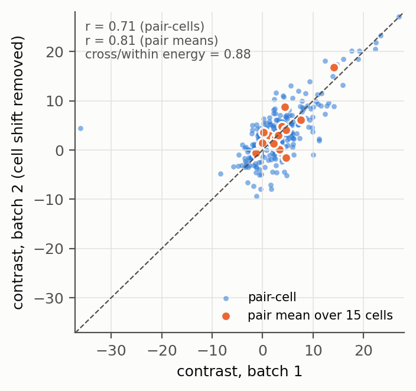

# What same-pair information supplies: a controlled decomposition of the interaction-prediction gap in the O'Neil screen

Vanshdeep Sehrawat

University of Nevada, Las Vegas · 10 November 2026

## Abstract

Held-out-pair models explain little interaction-specific variation in the O'Neil screen (noise-corrected R² at most 0.07), yet seeing the same pair in other cell lines raises R² from −0.050 to 0.218. We asked what that same-pair information consists of. We decomposed the frozen pair-cell Bliss contrast with cross-fitted estimators, ran predeclared anchor-cell experiments with negative controls, and audited reference sharing and replicate independence.

The contrast's energy splits into a pair-wide offset (0.242), pair-by-cell variation (0.660) and replicate noise (0.098). Interval widths are driven by drug and cell heterogeneity.

Held-out-pair models do not predict pair offsets: pair-mean R² is at most 0.06. In a strictly matched, leak-free comparison with the neural pair-seen model (B3), an empirical-Bayes pair intercept (B1) reaches R² 0.177, 81% of B3's 0.218. A linear cross-cell covariance predictor (B2) reaches 0.216 and matches the network.

With complete training pairs, transferable cell-specific structure adds 0.033 to 0.144 R² as the number of anchor cell lines grows from 1 to 38. It survives a train-only baseline that contains no held-out data. It vanishes when anchors come from another pair, even one sharing a drug (R² −0.27), and when anchor cells are deranged. It predicts an independent re-measurement batch as well as the original batch.

Its origin is not identifiable: it is unrelated to transcriptome-wide cell similarity, and the export has no plate or run metadata.

Three audit findings qualify earlier reports:
- Single-agent values are shared by all replicates and pairs.
- Replicate blocks share a batch component, so the reported 90% reproducibility is a within-batch, reference-conditional figure. Independent re-measurement (240 pair-cells) retains 88% of the within-batch reproducible energy after the cell-line batch shift.
- The frozen contrast lets test entries inflate matched oracles. The matched intercept falls from 0.205 to 0.177 when drug effects are refitted on training entries.

The evidence supports an explanatory section of the combined manuscript, not yet a stand-alone paper.

## 1 Question

The protocol asks whether the benefit of seeing a pair comes from three possible sources:
- (i) a pair-wide offset;
- (ii) a transferable cell-specific response profile;
- (iii) artifacts of response or reference construction and shared measurement.

It also asks what this implies about the gap between held-out-pair performance and the replicate ceiling. Model performance is not treated as an information limit. All analyses are CPU-only and use the frozen targets, folds and predictions. The design (models, anchor masks, seeds, hyperparameter grids, contrasts, materiality thresholds) was committed before any outcome was computed (commit c0a785c). The freeze file discloses the exploratory inspections done before it.

## 2 Data, unit and target

The unit is the pair-cell: 583 pairs of 38 drugs × 39 cell lines, a complete matrix of 22,737 pair-cells, built from 1,475,328 combination rows in 92,208 blocks.

The target is the frozen pair-cell Bliss contrast:
- Take the row-weighted pair-cell mean of unit-mean inhibition minus the frozen Bliss reference.
- Residualize it on additive endpoint-drug effects within each (pair fold, cell line) panel.

Sensitivity targets:
- the same contrast of measured inhibition (reference-free);
- the reference alone;
- an HSA residual;
- a residual from a drug-by-cell baseline fitted only on pairs of other folds (the protocol's train-only baseline);
- the Bliss contrast minus the held-out-pair F2 prediction (exploratory).

TARGET_AND_LEAKAGE_AUDIT.md gives the algebra and all counts.

## 3 Methods

**Variance components.**
- **Replicate noise** is estimated from block-sign half differences balanced within dose-grid groups (the frozen 50 draws). Equivalently, total energy minus the cross product of independent half-sample targets.
- **The pair-wide component** is the cross-cell U-statistic of the contrast, which is unbiased if noise is independent across cell lines.
- **Pair-by-cell** is the remainder.
- **Out-of-sample predictable shares** use leave-one-cell-out B1 and B2, with covariance from other pair folds.
- **Intervals** are pair-cluster bootstrap (2,000 draws), delete-one-drug jackknife and delete-one-cell jackknife.

**Anchor experiment (B).** For every held-out pair of the five frozen pair folds, k anchor cell lines (k = 0, 1, 2, 4, 8, 16) come from a permutation seeded by a hash of the pair identifier and seed (20 seeds). Evaluation uses the 23 cell lines at permutation positions 16 to 38, so rows are identical for every k and model.

- **B0** is zero (no same-pair information).
- **B1** is $k\hat\tau^2/(\hat s^2+k\hat\tau^2)$ times the anchor mean, with $\hat\tau^2$ and $\hat s^2$ from training pairs.
- **B2** is the best linear predictor under a cross-cell covariance. It is shrunk toward compound symmetry ($\lambda \in \{0, 0.25, 0.5, 0.75, 1\}$) and truncated to $r \in \{1, \dots, 38\}$ noise-corrected eigen-directions. Settings are chosen per target, fold and k on validation fold f+1, with covariance from the other three folds, then refitted on all four.
- **B4 and B5a** feed B1 or B2 the anchors of a training-fold donor pair sharing one drug or none.
- **B5b** feeds B2 the pair's own anchor values on deranged cells.
- **B3** is the saved neural pair-seen prediction. It appears only in the matched pair-cell split, where anchors are the pair's cell lines in the three training folds, B2 is selected on the validation fold, and out-of-fold predictions are evaluated through the frozen panel contrast.

**Experiment C.** The residual after the anchor-derived B1 intercept is compared between B1 and B2. Its replicate noise is propagated from the same split draws.

**Independent re-measurement.** 315 pair-cells (21 pairs × 15 cell lines) carry a second, separately deposited set of four blocks. 240 of them (16 pairs) use the same dose grid. Each batch alone was placed in the frozen contrast, and within-batch and cross-batch moments were compared.

**Grounding.** The cell-by-cell correlation of pair-centred targets was compared with cell-line expression similarity from DeepSynergy FARMS profiles, which are independent of combination outcomes, using a Mantel test and an expression-only predictor.

## 4 Results

### 4.1 Reproduction and replicate structure

All reported noise estimates reproduce bit for bit with the frozen block signs (Table 1). The dual-grid correction of the dose-shape noise share (0.447 → 0.363) stands. It arises because 210 pair-cells have two dose grids (135 rounding-level, 75 genuinely changed doses), and a split balanced only per pair-cell leaves those units with unbalanced signs.

Single-agent values are one shared number per drug, cell line and dose. They are identical across all 184,416 replicate groups, and their across-pair SD is 0.0006. The second batch reuses them. Reference uncertainty is therefore not identifiable from this export. Propagating an assumed single-agent error of SD 2, 5 or 10 inhibition points moves 0.25%, 1.6% or 6.4% of the target energy, almost none of it pair-wide.

**Table 1.** Frozen and recomputed noise estimates (Bliss contrast unless stated).

| Estimate | Frozen | Recomputed | Batch-aware split |
|---|---:|---:|---:|
| Pair-cell noise share | 0.0978041 | 0.0978041 | 0.0971 |
| Pair-cell noise share, measured response | 0.0671330 | 0.0671330 | |
| Cross-cell covariance share (unweighted) | 0.2337499 | 0.2337499 | |
| Dose-shape noise share, grid split | 0.3633470 | 0.3633470 | 0.3631 |
| Dose-shape noise share, per-pair-cell split | 0.4473365 | 0.4473365 | |

### 4.2 Variance components

Table 2 gives the decomposition for each target. The pair-wide component is essentially the same for the Bliss, measured-response, HSA and train-only targets (0.242 to 0.249). It is not inherited from the reference:
- Pair-wide covariance adds up: $\tau^2_{raw}$ 7.41 = $\tau^2_{ref}$ 2.44 + $\tau^2_{bliss}$ 4.99.
- Bliss pair means are uncorrelated with reference pair means (r = 0.009) and track measured-response pair means (r = 0.81).

Out of sample, B1 with all other 38 cell lines recovers 0.215 of the 0.242 pair-wide share. B2 adds 0.144 [0.116, 0.172; drug 0.076, 0.213], about a fifth of the pair-by-cell share. That leaves about 0.54 of the energy reproducible within batch but not linearly transferable (Figure 1).

Held-out-pair models fail on the offset. Pair-mean R² is −0.28 for production F2, −0.14 for selected F2, 0.06 for GP and 0.06 for CF. Their small total skill comes from pair-centred structure: selected F2 reaches 0.13 there.

Negative controls behave as expected:
- Permuting pair labels within panels gives a pair-wide share of 0.0007 ± 0.0016.
- Zero-interaction data give a noise share of 0.988 and leave-one-cell-out R² at or below 0.

**Table 2.** Shares of pair-cell contrast energy with pair-bootstrap intervals; leave-one-cell-out (LOCO) R² uses all other cell lines of the pair.

| Target | Noise | Pair-wide | Pair-by-cell | LOCO B1 | LOCO B2 |
|---|---:|---:|---:|---:|---:|
| Bliss (primary) | 0.098 [0.089, 0.108] | 0.242 [0.197, 0.293] | 0.660 [0.613, 0.702] | 0.215 | 0.360 |
| Measured response | 0.067 | 0.247 | 0.686 | 0.225 | 0.420 |
| Train-only baseline | 0.103 | 0.249 | 0.648 | 0.217 | 0.382 |
| HSA | 0.095 | 0.248 | 0.657 | | |
| Reference only | 0 | 0.264 | 0.736 | 0.249 | 0.620 |

### 4.3 Within-batch versus independent re-measurement

Placing either batch alone in the contrast reveals a large cell-line batch shift (4.9 contrast units). Unadjusted, the mean squared batch difference is 4.5 times what within-batch noise predicts. A complete re-run would remove the cell-line shift through the contrast; after removing it, the ratio is 1.8 (Table 3, Figure 2).

Of the within-batch reproducible energy, 88% [65%, 101%] replicates across batches: 89% of the pair-wide part and 85% of the pair-by-cell part. The batch-specific variance is about 0.8 to 0.9 times the within-batch replicate noise.

The re-tested pairs have an unusually strong pair-wide component (0.449 against 0.242), so extrapolation is uncertain. If batch variance scales with replicate noise, the cross-batch ceiling for the full screen is about 0.82. If it is constant, about 0.67.

**Table 3.** Moments of the Bliss contrast in 240 pair-cells measured in two batches (contrast units squared), cell-line batch shift removed.

| Component | Within batch | Across batches | Ratio [pair interval] |
|---|---:|---:|---:|
| Reproducible energy | 41.0 | 36.0 | 0.88 [0.65, 1.01] |
| Pair-wide | 25.5 | 22.8 | 0.89 [0.52, 0.97] |
| Pair-by-cell | 15.5 | 13.2 | 0.85 [0.62, 1.16] |

<!-- width: 0.5 -->

### 4.4 Anchor information curves

Both same-pair predictors improve with anchor cells (Table 4, Figure 3a). B1 rises from 0.049 at one anchor to 0.194 at 16. B2 exceeds it at every k, and the gap widens from 0.033 to 0.086 [0.071, 0.102; drug 0.048, 0.124]. B2 is ahead for 70.5% of pairs and in all five folds.

The train-only target, which contains no held-out data in any value, reproduces the curves within 0.004 for k ≤ 16.

The controls rule out identity covariation and leakage:
- Anchors from a donor pair give R² of −0.18 (B1) and −0.27 (B2) at k = 16, and sharing a drug does not help (difference at most 0.02).
- Deranging the anchor cells drops B2 to 0.085, below B1.

After subtracting the held-out-pair F2 prediction, B2 still adds 0.062. The transferable structure is mostly not what drug features already capture.

Experiment C: at k = 16, B2 removes 10.7% [8.9%, 12.6%] of the residual left by the anchor intercept, or 12.2% of its reproducible part.

**Table 4.** Pooled R² on identical evaluation rows (Bliss contrast), pair-bootstrap intervals; controls use B2.

| k | B1 | B2 | B2 − B1 | Donor sharing a drug | Deranged anchors |
|---:|---:|---:|---:|---:|---:|
| 1 | 0.049 | 0.081 | 0.033 [0.024, 0.041] | −0.087 | |
| 2 | 0.083 | 0.130 | 0.047 [0.038, 0.056] | −0.132 | −0.013 |
| 4 | 0.123 | 0.178 | 0.055 [0.047, 0.063] | −0.176 | 0.040 |
| 8 | 0.164 | 0.227 | 0.063 [0.054, 0.072] | −0.213 | 0.089 |
| 16 | 0.194 | 0.280 | 0.086 [0.071, 0.102] | −0.267 | 0.085 |
| 38 (LOCO) | 0.215 | 0.360 | 0.144 [0.116, 0.172] | | |

### 4.5 Matched comparison with the neural pair-seen model

In the frozen pair-cell split, with anchors and covariance whose drug effects are refitted on training entries only:

| Model | R² | Pair interval |
|---|---:|---:|
| B1 | 0.177 | [0.143, 0.212] |
| B2 | 0.216 | [0.181, 0.250] |
| B3 (network) | 0.218 | |
| Held-out-pair F2 (same rows) | −0.050 | |

- **B3 − B1** is 0.041, positive in five of five folds.
- **B3 − B2** is 0.003, with mixed fold signs.
- **The intercept reaches 81% of the network.** That is below the predeclared 90% threshold for “the intercept explains almost all of the pair-seen gain”.
- **The network extracts about as much cell-specific transfer as a linear covariance model**, and no more.

With frozen-contrast anchors and covariance, B1 and B2 read 0.209 and 0.309. A fixed-setting attribution assigns about 0.05 of B2's inflation to anchors that carry other pairs' test entries and about 0.05 to covariance estimated in panels that contain them.

### 4.6 Is the transferable structure biological?

The cell-by-cell structure of pair-centred contrasts is reproducible across disjoint halves of the pairs (Spearman 0.62, p = 0.0005). It is barely related to expression similarity:
- Mantel ρ is 0.069 (p = 0.08) for the Bliss contrast and 0.121 (p = 0.002) for measured response.
- An expression-only covariance adds 0.002 [−0.002, 0.006] over B1, 1% of B2's gain.

Within the 16 re-tested pairs, B2's gain is the same when scored against the independent batch (0.030 [−0.015, 0.086]) as against the original (0.033 [−0.030, 0.106]). That argues against a purely within-batch artifact, but the sample is small. Co-processed cell lines remain a live explanation.

## 5 Corrections to earlier statements

1. **“About 90% reproducible”** is technical reproducibility within a batch, conditional on single-agent values shared by all replicates and pairs. Across independent batches it is lower, plausibly 0.67 to 0.82 of the energy.
2. **The matched cross-cell oracle of 0.205** used contrasts whose drug effects were fitted with test entries. Leak-free, the matched intercept is 0.177 [0.143, 0.212].
3. **The pair-seen gain is not only an intercept.** The intercept supplies 81% of the network's R²; the rest is cell-specific transfer of the size a linear covariance model achieves.
4. **The dose-shape noise share of about 36%** and the pair-cell share of 9.8% stand. They are distinct quantities.

## 6 Why held-out pairs remain hard

Three facts together explain the gap:

1. **Pair offsets are invisible without the pair.** A quarter of the contrast energy is a pair-specific offset shared across cell lines. Drug identities and features do not predict it for an unseen pair, and the models' pair-mean errors are negative R².
2. **Same-pair data fix the offset quickly.** The intercept needs few cell lines (0.12 R² at four anchors) and carries most of the benefit.
3. **The dominant component is pair-by-cell.** It is reproducible but only partly transferable even from the same pair: 38 anchor cell lines recover about a fifth of it linearly. Without the pair it is reachable only through features, which recover 0.13 of the pair-centred energy at best.

The remaining gap to the within-batch ceiling is partly a ceiling artifact (batch-specific variance). It is mostly pair-by-cell variation that neither identities nor same-pair profiles predict.

## 7 Limitations

- **One screen and one contrast definition.** The cross-batch estimate rests on 16 strong-interaction pairs.
- **Unidentifiable components.** Reference error and run structure cannot be identified; the origin of the cell-similarity structure is unresolved.
- **B3 uncertainty is fold-level only.** Per-pair B3 energies were not transferred.
- **The frozen contrast depends on the test set.** It is the estimand of record but is unsafe for comparisons in which test entries share panels with training entries.
- **No new neural training was run.** No discriminating question requires it: the network already matches the linear covariance model under matched information.

## 8 Decision on Paper 1

Keep this as the explanatory section of the combined manuscript. The decomposition is reproducible, out of sample and controlled. But its main message, that same-pair benefit is mostly an identity-level intercept plus a linear cell transfer the network already captures, refines rather than departs from the one-hot-shortcut and split-sensitivity literature [1, 2]. The potentially new component lacks biological grounding.

A stand-alone paper would need:
- the same decomposition in a second screen (NCI-ALMANAC is available locally);
- the cell-similarity structure tied to an independent annotation or to run metadata.

Adaptive screen design [3, 4] is outside the claims made here.

## 9 Reproducibility

The scripts in experiments/interaction_structure run from the repository root in this order:
- `variance.py`;
- `anchors.py`;
- `grounding.py`, `batch_transfer.py` and `dose_shape_check.py`;
- `figures.py`.

They take the observation table and the frozen resolution cache (interaction_analysis/resolution) as inputs. README.md gives the full commands. The full sequence runs in about five minutes on 16 CPU threads. Tests: `python -m pytest tests/test_interaction_gap.py` (11 synthetic checks, including leakage canaries and estimator recovery). The full suite gives 140 passed and 1 skipped. Input, script and output hashes are in results/interaction_structure/MANIFEST.json.

## References

1. Çandır et al. One-hot news: drug synergy models shortcut molecular features. Bioinformatics 42(3):btag040 (2026). doi:10.1093/bioinformatics/btag040
2. Tasnina N, Haghani M, Murali TM. SynVerse: a modular framework for building and evaluating deep learning-based drug synergy prediction models. Briefings in Bioinformatics 26(6):bbaf676 (2025). doi:10.1093/bib/bbaf676
3. Tosh et al. A Bayesian active learning platform for scalable combination drug screens. Nature Communications 16 (2025). doi:10.1038/s41467-024-55287-7
4. Wang, Allauzen, Nghe, Opuu. A guide for active learning in synergistic drug discovery. Scientific Reports (2025). doi:10.1038/s41598-025-85600-3
