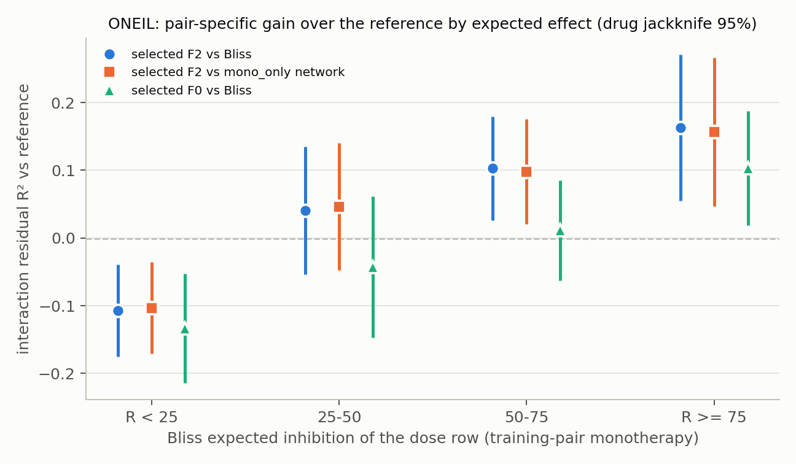

# Overnight experiments, 2026-11-05/06

Three experiments using existing artifacts and the frozen neural protocol: no
hyperparameter search and no retuning on test data. Each analysis plan was committed
before its numbers were computed. Commit order:
- `1c0dfc5` ALMANAC protocol;
- `12ff1bd` regime plan;
- `a1a8890` and `dced3d3` post hoc controls, each declared before computing;
- `249212c`/`1933779` ALMANAC confirmation test;
- `9a9b1a1` ALMANAC fold amendment;
- `0c069b5` ALMANAC site check.

## 1. Native Loewe fallback audit (CPU)

**Question.** The Loewe score in DrugComb comes from SynergyFinder's R scorer. When
`nleqslv` returns code ≥ 3 the scorer replaces the Loewe expectation with a fallback:
the larger single-drug response at the summed dose. A 200-block native probe had found
98 fallback cases that do have a valid Loewe root. This audit checks those 98, extends
the check to every case behind the 92,208 ONEIL blocks, and measures the effect on
scores and on predictions.

**The 98 probe cases** (native R 3.6.3 fits, `results/loewe_audit/probe_98_cases.csv`).
- All 98 are confirmed. Each has a root on the joint domain of two increasing curves,
  and the scorer's own Loewe equation has residual ≤ 6e-7 there.
- In every case the scorer output equals the capped summed-dose fallback exactly.
- **Codes.** 82 cases end with code 3, 16 with error 999.
- **The fallback is not needed.** In all 82 code-3 cases, nleqslv's own solution lies
  within 0.042 of the valid root (median 0.008), and the scorer discards it.
- **Size of the error.** Fallback minus valid reference: mean +19.2, median +3.0, max
  +92.7 inhibition points (RMSE 34.4). The fallback never understates the expected
  response by more than 0.001, so the Loewe score understates synergy.

**All 367,152 cases** (22,947 fitted surfaces, cached coefficients, native solver;
`results/loewe_audit/loewe_audit.json`).

| Native outcome / strict root | Cases | Surfaces |
|---|---:|---:|
| Accepted, root defined | 179,963 | 17,616 |
| Accepted, curve not increasing | 2,284 | 468 |
| **Fallback, root defined** | **13,223** | **5,040** |
| Fallback, no joint root | 118,718 | 14,518 |
| Fallback, curve not increasing | 48,916 | 3,180 |
| Fallback, disjoint effect ranges | 4,048 | 253 |

- **How often.** 50.4% of cases fall back. 7.2% of those (3.6% of all cases) have a
  valid root.
- **Solver agreement.** Accepted solutions match the strict root to within 2.7e-6.
- **Code-3 cases.** 98.1% have a solver answer within 0.05 of the root.
- **Size of the error.** Fallback minus valid reference: mean +21.3, median +4.6, max
  +103.9 (RMSE 36.1). Error-999 cases are larger: median +23.9, mean +37.9.

**Effect on scores.** We replaced the fallback with the valid root wherever one exists.
- **Blocks.** 20,076 of 92,208 blocks change (21.8%; 572 of 583 pairs; all 39 cells).
  - The Loewe score rises by a mean of 3.52 (median 1.41, max 51.1).
  - 10,892 blocks shift by ≥ 1, 4,608 by ≥ 5 and 1,992 by ≥ 10.
  - 1,871 blocks change sign.
- **Pair-cell panel.** 4,954 of 22,737 units change; 1,141 shift by ≥ 5. The Spearman
  correlation between the original and corrected panels is 0.979.
- The native forward reconstruction matches the published scores (block RMSE 0.70), so
  these shifts apply to the published DrugComb Loewe labels.

**Effect on predictions.** The test uses existing out-of-fold predictions from the
identity network trained on published Loewe labels (pair folds, `phase2_panel_neural`).
- **Affected units (4,954).** R² is 0.526 against published labels but 0.239 against
  corrected ones; Pearson falls from 0.726 to 0.643. RMSE barely moves (8.87 vs 8.75).
- **What that means.** About 39% of the label variance on affected units comes from the
  fallback. The model partly reproduces it: its error correlates 0.43 with the label
  shift. Fallback occurrence depends on drug-cell monotherapy curves, so
  identity-based models can learn it.
- **All units.** R² 0.593 vs 0.572, contrast R² 0.338 vs 0.324.
- **Response-level models are immune.** A Loewe score derived from predicted responses
  uses the same reference as the label, so the artifact cancels in its error. Our
  F0/F2 networks predict inhibition and are unaffected.

**Limitations.**
- The full audit uses the cached Python-generated coefficients, not native refits.
  Native fitting differs slightly (reference RMSE 1.07 vs 1.12 on the probe).
- The generating release, its settings and the original assay files are unknown.
- The strict root is defined only for two increasing curves. Fallbacks with no root
  (no joint root, disjoint ranges or non-increasing curves) have no correct value and
  are left unchanged.
- The valid root is one defensible convention; the source's fallback choice is
  public, so this is a numerical-policy finding, not a hidden bug claim.

## 2. Interaction-specific signal beyond Bliss (CPU, existing out-of-fold predictions)

The plan is `configs/beyond_bliss_regimes.json`, plus two post hoc controls, each
declared before it was computed. Units are pair-cell means within each regime. P
removes drug main effects within fold and cell. Intervals are delete-one-drug
jackknife; the seeds are 2026–2028. Results are in `results/beyond_bliss_regimes/`.

**Pooled** (already known). Interaction residual R² vs Bliss: selected F2 0.064
[−0.037, 0.165], selected F0 −0.013 [−0.114, 0.088]. Not established.

**By Bliss expectation R** (selected F2, Holm over 7 regimes):

| Regime | Pair-cells | Interaction residual R² [jackknife] | Holm p | Seeds | vs isotonic-calibrated Bliss | vs identity-free mono_only network |
|---|---:|---|---:|---|---|---|
| R < 25 | 19,687 | −0.107 [−0.176, −0.039] | 0.021 | all < 0 | −0.099 [−0.166, −0.032] | −0.103 [−0.170, −0.036] |
| 25–50 | 17,808 | 0.041 [−0.053, 0.135] | 0.39 | | 0.041 | 0.046 |
| 50–75 | 16,114 | 0.103 [0.026, 0.179] | 0.050 | all > 0 | 0.093 [0.016, 0.169] | 0.098 [0.021, 0.175] |
| **R ≥ 75** | 14,380 | **0.163 [0.055, 0.271]** | **0.025** | 0.193 / 0.140 / 0.156 | **0.162 [0.053, 0.271]**, Holm 0.032 | **0.157 [0.047, 0.267]**, Holm 0.039 |

- **Every fold agrees** (descriptive, seed-averaged energies). R ≥ 75 is positive in 5/5
  folds (0.126, 0.056, 0.077, 0.269, 0.321); R < 25 is negative in 5/5 (−0.121,
  −0.141, −0.077, −0.073, −0.138).
- **Dose regions show the same pattern, without significance.** Low/low doses −0.057,
  mixed 0.080, high/high 0.109 [0.001, 0.218], Holm 0.20.
- **Selected F0 shows the same shape, weaker.** R < 25: −0.133, Holm 0.014. R ≥ 75:
  0.103 [0.019, 0.187], Holm 0.09.
- **The controls rule out simpler explanations.**
  - *Bliss miscalibration.* Isotonic recalibration of Bliss alone adds ≤ 0.011 in
    every regime, so a monotone miscalibration of Bliss does not explain the gain.
  - *A better monotherapy-based reference.* The sprint's `mono_only` network
    (monotherapy inputs, no identities) adds ≤ 0.007 over Bliss in every regime. A
    learned two-argument surface of the monotherapies does not explain it either.
  - What remains needs drug or pair identity.



**Pairs.** Per-pair gains were computed separately on two random halves of the 39
cells.
- **They replicate.** Spearman between halves: F2 0.478 [0.345, 0.611]; F0 0.516
  [0.367, 0.665].
- **But in both directions.** 180 pairs gain in both halves and 197 lose in both.
- **The net gain is concentrated.** The 20 most consistent pairs carry 94% of F2's net
  gain. The largest are GELDANAMYCIN+MK8776 (77% of its Bliss interaction energy
  removed), GELDANAMYCIN+MK4827, ERLOTINIB+VINBLASTINE and BORTEZOMIB+MK4827.

**Drugs** (pair-cluster bootstrap, Holm over 38 drugs).
- **F2 gains.** Pairs containing PACLITAXEL (0.388 [0.209, 0.509]) and MK4541
  (0.174 [0.079, 0.270]) gain significantly; for both, no bootstrap draw out of 2,000
  is ≤ 0.
- **F0 losses.** F0 is significantly worse than Bliss on pairs with METHOTREXATE
  (−0.375), DEXAMETHASONE (−0.355) and TEMOZOLOMIDE (−0.302).

**Reading.**
- The networks learn reproducible pair-specific departures from Bliss, but those help
  only where the Bliss expectation is high. At low expected effect they are noise
  that hurts, and the two cancel in the pooled metric.
- Because it is exploratory and post hoc on an examined screen, this is a hypothesis.
  It was frozen as a prospective test on ALMANAC (section 3).

## 3. ALMANAC external validation (GPU, RebelX)

**Prior work, kept separate.**
- The October investigations profiled the NCI raw ALMANAC file. They ran a
  pre-registered panel-level SCORE replication (contrast R² 0.158 CF, 0.136 kernel
  ridge, 0.082 MLP) and a forecasting gate that failed.
- None of that used dose-level inhibition, the shared pair-fold protocol or these
  networks. Everything below is new.

**Feasibility checks** (profile of the DrugComb v1.4 export).
- **Data.**
  - 5,077,768 ALMANAC rows: 2,873,514 combination rows in 311,604 blocks.
  - Grids are 3×3 (300,091 blocks) or 5×3 (11,513).
  - 103 drugs, 60 cells, 5,142 pairs; all doses in uM.
- **Target.** The same DrugComb inhibition field.
  - For ALMANAC it equals 100 − PercentGrowthNoTZ (verified against the NCI file
    below): growth relative to vehicle control without time zero, from the NCI-60 SRB
    assay. ONEIL's comes from CellTiter-Glo viability.
  - Both are viability-type percentages. ALMANAC's tops out at 100 (maximum
    100.0016); ONEIL has 2,155 rows above 100.
  - Most ALMANAC combination rows are low-effect: median 7.7, versus 46.8 for ONEIL.
- **Monotherapy.** DrugComb block edges hold single-agent wells for every block. The
  F2 lookup averages training-pair edges at exact drug/cell/dose keys and interpolates
  absent doses, as in `f2_combined`.
- **Cross-study transfer is not valid.** Only 14 drugs and 9 cells overlap with ONEIL,
  the targets differ, and the dose ranges differ. A frozen ONEIL network applied to
  ALMANAC would mostly measure assay calibration, so it was not run.
- **What was run instead.** The frozen architecture and protocol, retrained on
  ALMANAC.

**Protocol** (`configs/almanac_validation.json`).
- **Models.** `f0_combined` and `f2_combined`, copied unchanged from the ONEIL sprint.
  `f0_combined` was selected in 5/5 ONEIL folds, and `f2_combined` is the
  configuration declared for confirmation.
- **Training.** Three seeds. Generated label-free pair folds (seed 2026). Validation
  fold (f+1)%5 only stops training; nothing is selected.
- **Baselines.** Mean, additive ridge and the training-pair Bliss rule.
- **Statistics.** The same verdict rule and intervals as the ONEIL report.
- **Amendment** (`configs/almanac_validation_amendment.json`), made before any test
  output existed:
  - NSC707389 occurs in only 2 pairs and broke the seen-drug rule, so drugs with
    fewer than 10 pairs are excluded;
  - folds must keep held-out drugs seen in training, and seed 2026 satisfies this
    after the exclusion;
  - the first, invalid runs are kept aside on the cluster.

**Prospective regime test** (`configs/almanac_regime_confirmation.json`).
- **Hypothesis.** H1 states that `f2_combined` beats Bliss on the interaction contrast
  at R ≥ 75: the drug-jackknife interval must lie above 0 and every seed must be
  positive.
- **When it was frozen.** At 22:57 PST, after the first training jobs had started but
  before any ALMANAC run finished and before any ALMANAC output was viewed. The jobs
  were later restarted under the amendment.

**Execution.**
- **Data after the amendment.** 2,871,834 combination rows, 5,140 pairs, 102 drugs and
  60 cells. Monotherapy inputs: 2,821,220 rows have exact keys, 50,614 are
  interpolated and none are imputed.
- **Runs.** 30 network runs on RebelX GPUs, all at commit `9a9b1a1` with a clean tree.
- **Stopping.**
  - f0_combined: best epochs 92–192 (median 120). Three of 15 runs reached the frozen
    200-epoch budget with their best epoch in the last 20, so they may be
    under-trained.
  - f2_combined: best epochs 34–130 (median 89), none at the budget.

Results are in `results/almanac_validation/`.

| Model | RMSE (seed SD) [pair bootstrap] | Drug jackknife | MSE | MAE | R² | Pearson | Contrast R² [jackknife] | Interaction residual R² vs Bliss [jackknife] |
|---|---|---|---|---|---|---|---|---|
| f2_combined | 9.49 (0.028) [9.32, 9.67] | [8.73, 10.25] | 90.1 | 6.17 | 0.894 | 0.946 | 0.668 [0.581, 0.755] | 0.403 [0.243, 0.564] |
| f0_combined | 9.91 (0.091) [9.74, 10.10] | [9.07, 10.75] | 98.2 | 6.53 | 0.885 | 0.941 | 0.644 [0.556, 0.733] | 0.361 [0.203, 0.518] |
| Bliss reference | 11.85 [11.62, 12.07] | [10.71, 12.98] | 140.3 | 7.49 | 0.835 | 0.915 | 0.443 [0.296, 0.590] | 0 |
| Additive ridge | 21.93 [21.77, 22.09] | [20.73, 23.12] | 480.7 | 17.01 | 0.435 | 0.660 | 0.122 [−0.018, 0.263] | −0.576 |
| Training mean | 29.18 [28.95, 29.40] | [27.26, 31.10] | 851.3 | 23.56 | −0.000 | −0.011 | 0 | −0.796 |

**Declared comparisons.** All four show lower error under every criterion of the
verdict rule.

| Comparison | ΔMSE [pair bootstrap] | Drug jackknife | ΔMSE % | Folds | Seed pairs | Pairs lower |
|---|---|---|---|---|---|---|
| f2_combined − f0_combined | −8.18 [−9.59, −6.88] | [−11.73, −4.63] | −8.3% | 5/5 | 9/9 | 70.6% |
| f2_combined − Bliss | −50.25 [−53.75, −46.54] | [−68.81, −31.68] | −35.8% | 5/5 | 3/3 | 86.0% |
| f0_combined − Bliss | −42.06 [−45.53, −38.39] | [−59.44, −24.69] | −30.0% | 5/5 | 3/3 | 71.4% |
| f0_combined − additive | −382.5 [−388.7, −376.3] | [−426.1, −338.8] | −79.6% | 5/5 | 3/3 | 99.4% |

**Regime test** (f2_combined vs Bliss; seeds 2026/2027/2028; Holm over 4 bins):

| Bliss level R | Pair-cells | Interaction residual R² [jackknife] | Seeds | Holm p | vs calibrated Bliss |
|---|---:|---|---|---:|---|
| R < 25 | 297,245 | 0.246 [0.151, 0.342] | 0.245 / 0.242 / 0.251 | 3e-6 | 0.245 |
| 25–50 | 134,596 | 0.415 [0.253, 0.578] | 0.406 / 0.422 / 0.417 | 3e-6 | 0.415 |
| 50–75 | 98,311 | 0.362 [0.269, 0.455] | 0.355 / 0.364 / 0.368 | 3e-11 | 0.362 |
| **R ≥ 75** | 68,627 | **0.373 [0.259, 0.487]** | 0.361 / 0.384 / 0.376 | 1e-8 | 0.373 |

- **H1 is confirmed.** The interval lies above 0 and all seeds are positive.
- **H2 is not.** Unlike ONEIL, the network also beats Bliss at low expected effect,
  and the pooled gain is large.
- f0_combined is positive in every bin too (0.21–0.36).
- Recalibrating Bliss changes nothing (all differences ≤ 0.002).

**Comparison with ONEIL** (same frozen models, same rule).
- **Response.** The gains over Bliss replicate in size: −35.8% MSE on ALMANAC vs
  −28.7% on ONEIL.
- **Information.** F2 again beats F0, so monotherapy information helps.
- **Interaction.** The interaction-specific gain is far larger on ALMANAC: 0.40 vs
  0.06 pooled.
- **Plausible reasons:**
  - each ALMANAC drug occurs in about 100 pairs, versus 22–37 in ONEIL, so
    identity-based interaction structure has far more training pairs;
  - pair-level batch effects (below).

**Site confound check** (`configs/almanac_site_check.json`, post hoc). Every ALMANAC
pair was screened at one site. We matched DrugComb rows to the NCI raw file on cell,
both concentrations and inhibition:
- 2,538,062 of 2,873,514 combination rows match exactly, which confirms that DrugComb's
  ALMANAC inhibition is 100 − PercentGrowthNoTZ;
- 5,141 pairs are mapped: FF 2,686, FG 2,455, median pair purity 0.99;
- on median, 71% of a drug's pairs are at one site, so identity partly predicts site.

Interaction residual R² of f2_combined vs Bliss, with drug main effects removed within
fold, cell and site (`results/almanac_validation/site_check.csv`):

| Bliss level | Within fold, cell and site | FF pairs only | FG pairs only |
|---|---|---|---|
| All rows | 0.334 [0.205, 0.464] | 0.333 [0.148, 0.519] | 0.337 [0.264, 0.410] |
| R < 25 | 0.193 [0.113, 0.272] | 0.174 [0.062, 0.287] | 0.228 [0.144, 0.313] |
| 25–50 | 0.343 [0.216, 0.470] | 0.339 [0.157, 0.521] | 0.355 [0.283, 0.428] |
| 50–75 | 0.292 [0.200, 0.385] | 0.290 [0.158, 0.423] | 0.297 [0.221, 0.372] |
| R ≥ 75 | 0.328 [0.165, 0.491] | 0.328 [0.098, 0.557] | 0.328 [0.195, 0.461] |

- **Site explains only a little.** Removing site main effects lowers the pooled gain
  from 0.403 to 0.334 (f0_combined: 0.361 to 0.292).
- **The rule is met.** Every cell of the table is positive in all three seeds, with a
  drug-jackknife interval above 0.
- **What this does not rule out.** Plate-level batch effects within a site,
  site-by-drug-by-cell structure, and differences in the time-zero convention remain
  possible.

## 4. Is there a publishable novel result?

**Not yet a publishable novel result.** There are two candidates, one strong and one
partial.

**1. Loewe fallback artifact: solid, modest novelty.**
- **Finding.** In the DrugComb ONEIL export, the scorer substitutes its fallback in
  13,223 dose cases that have a valid Loewe root. In 89% of them its own solver had
  already landed within 0.05 of that root.
- **Effect.** The substitution shifts 21.8% of block Loewe scores (1,871 sign flips).
  On affected units it inflates the apparent R² of an identity model trained on those
  labels from 0.24 to 0.53.
- **Status.** Reproducible from public code and data. The fallback branch itself is
  public behavior, so this is a data-quality note or technical comment, not a method
  paper.
- **Before submission.** Native refits on all blocks, the other DrugComb studies, and
  a check of whether current SynergyFinder releases behave the same.

**2. Beyond-Bliss interaction on unseen pairs: promising, not established.**
- **ONEIL.** The networks' interaction-specific gain is not established (0.06 pooled).
  It is concentrated at high expected effect (0.16 at R ≥ 75) and negative at low
  effect.
- **ALMANAC.** The same frozen architectures, retrained, give a large and consistent
  gain (0.40 pooled; 0.33 within site; positive in every Bliss-level bin and seed)
  beyond Bliss and recalibrated Bliss. Response MSE is lower in every fold.
- **What replicated, and what did not.**
  - The pre-declared H1 (R ≥ 75) is confirmed.
  - The low-effect penalty did not replicate (H2 fails).
  - So "gains only at high effect" is not a general law; the general claim is the
    ALMANAC-sized interaction signal.
- **Why it is not yet publishable:**
  - ALMANAC was examined before at panel level, and our own October work and the
    literature (comboFM, PMF on ALMANAC, pairwise kernel ridge) already report
    beyond-additive predictability there. The new part, a dose-level interaction
    contrast against Bliss with frozen networks across two screens, is incremental.
  - The ONEIL–ALMANAC difference is unexplained: pairs per drug, assay,
    effect-size distribution and plate effects are all candidates.
  - Three of 15 F0 runs were budget-limited.
  - The folds are generated, not published.
- **What would establish it:**
  - a third screen, untouched, with these models and this test frozen;
  - plate-level controls on ALMANAC;
  - a pair-count dose-response, subsampling ALMANAC pairs per drug to ONEIL's level
    with validation only.

**Everything else is negative or confirmatory.**
- The GP review found no reproducible support for the PR's numbers.
- The GP is 151% worse than F0 on the shared protocol.

## Reproduction

```sh
python -m cs622.loewe_audit --output results/loewe_audit
python -m cs622.regimes --output results/beyond_bliss_regimes
python -m cs622.regimes --addendum --output results/beyond_bliss_regimes
python -m cs622.data --config configs/data_almanac.json
python -m cs622.suite run --protocol configs/almanac_validation.json --output results/neural/runs/almanac_v1 --stage all --device cuda
python -m cs622.cv run --config configs/almanac_mean.json --output results/neural/runs/almanac_mean
python -m cs622.cv run --config configs/almanac_additive.json --output results/neural/runs/almanac_additive
python -m cs622.cv run --config configs/almanac_reference_bliss.json --output results/neural/runs/almanac_reference_bliss
python -m cs622.almanac_report --output results/almanac_validation
python -m cs622.almanac_sites --nci ComboDrugGrowth_Nov2017.csv --output results/almanac_validation/pair_screener.csv
python -m cs622.almanac_report --output results/almanac_validation --site-map results/almanac_validation/pair_screener.csv
```

The Loewe audit reads `results/neural/runs/{scientific_native_full,
phase3_native_attribution_v3, phase2_panel_neural}` from the scoring audit on
`feat/cs622-neural-pipeline`. `--addendum` runs both post hoc controls (calibrated Bliss and
mono_only).

On RebelX the 20 benchmark-seed runs were executed from explicit run lists with
`cs622.suite.execute`, after the suite's static sharding left one GPU idle. Run
configurations and outputs are unchanged by this.
